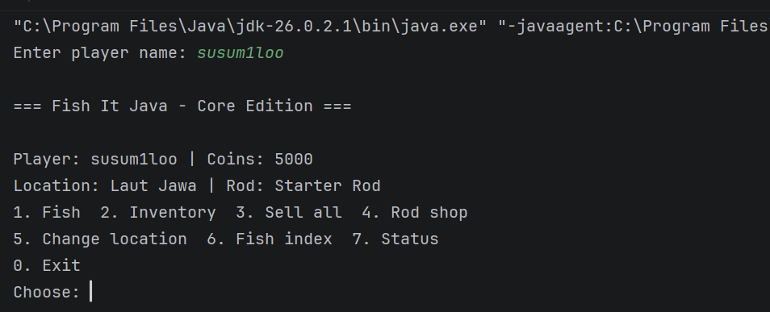
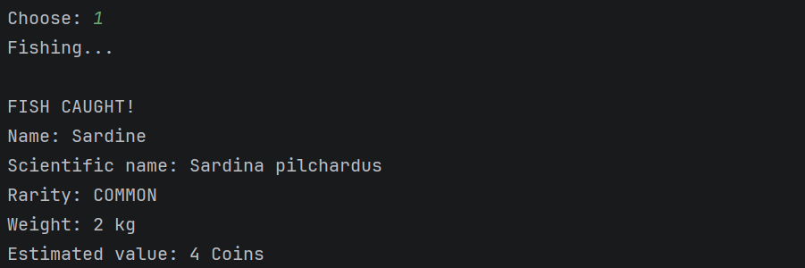
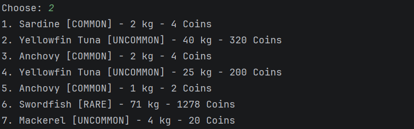
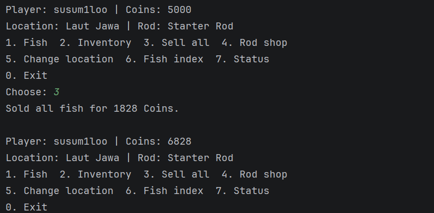
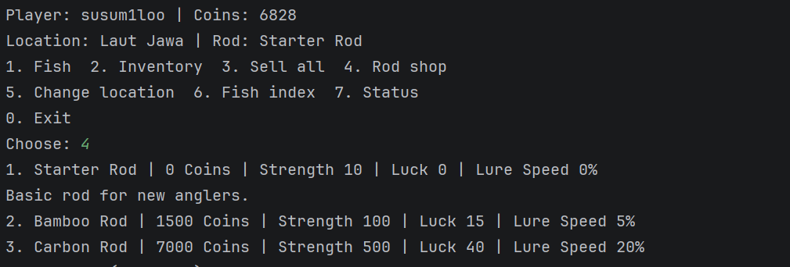
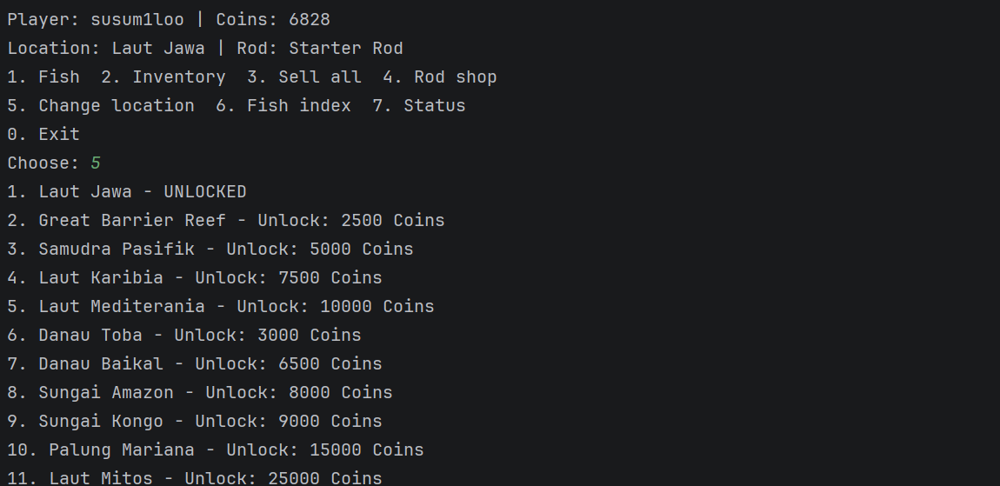
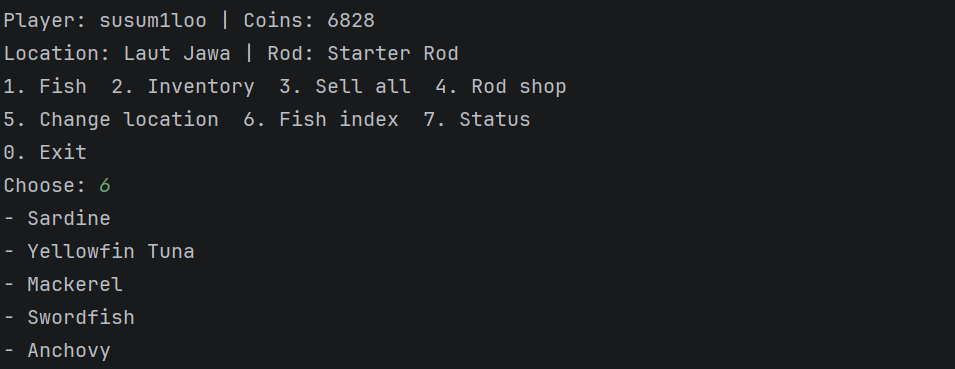
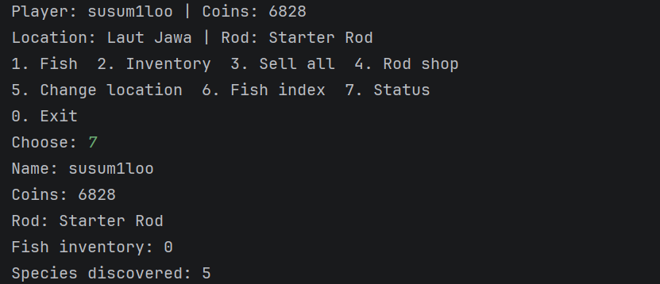

Nama: Limarhandi Hafidz
NIM: H1D025111
Tema: Game

Petunjuk

1. Buka terminal pada direktori project
2. Compile seluruh file dengan perintah: 'javac -d out src/*.java'
3. Jalankan program dengan perintah: 'java -cp out Main'

Petunjuk bermain

1. Fish: Melakukan aktivitas memancing secara otomatis, ikan yang diperoleh akan masuk ke inventory.
2. inventory: melihat daftar ikan yang berhasil ditangkap.
3. Sell all: Menjual seluruh ikan dalam inventory.
4. Rod shop: melihat dan membeli fishing rod menggunakan coins.
5. Change location: Memilih lokasi mancing. Beberapa lokasi perlu dibuka menggunakan coin.
6. Fish index: Melihat daftar spesies ikan yang sudah berhasil ditemukan.
7. Status: Melihat seluruh informasi.
8. Exit: Keluar.

Output Program

### Menu Utama

### Hasil Memancing

### Inventory

### Penjualan Ikan

### Rod Shop

### Pemilihan Lokasi

### Fish Index

### Status Pemain
